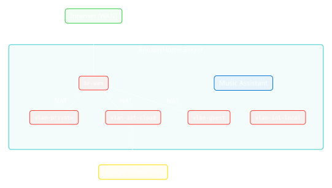
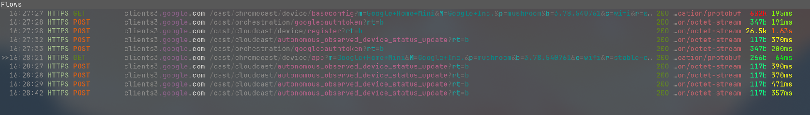

+++
title = "Taking the Google out of Google Home Mini with Nginx and Music Assistant"

[taxonomies]
tags = ["reverse-engineering", "networking", "mitm", "nixos"]
+++

A long time ago I bought a 1st generation Google Home Mini
and have been using it ever since.
Nowadays, I keep its microphone muted and use it as a glorified speaker
for [Music Assistant].
However, it was bugging me that it still connected to Google's servers all the time,
so last weekend I decided to attempt cutting it off from the internet.
<!-- more -->

I did all of this research old-school style: I did not use any fancy "agents".
My goal here is to learn and have fun, and throwing a machine at the problem achieves neither.

For the scope of this post,
the Google Home Mini has already been set up through the official Home app
and is connected to a Wi-Fi network.

## The Problem

Google Home devices are meant to be always-online and connected to Google's servers.
Blocking internet access disables the entire device,
even the features that should work offline like casting from Music Assistant.

For the past few years, I've been trying to reduce my dependence on tech giants, especially Google,
and my Google Home Mini was one of the last pieces I had not found a solution for yet.
Perhaps most importantly, I wanted to decrease its reliance on Google
without having to replace the device itself.

Therefore, to achieve this, I would have to let the device believe it is online,
while simultaneously blocking all unwanted connections to Google.

## My Home Networking

Before anything else, a quick preamble about how my network is set up.
I live in a small student accommodation that provides me with
a WAN connection via an Ethernet port on the wall[^fn-wan].
Connected to the WAN, I have a mini PC with NixOS[^fn-nix-config] that acts as both my router and my home server,
running Home Assistant and Music Assistant.

My network has 4 VLANs: `vlan-private`, `vlan-iot-cloud`, `vlan-iot-local`, and `vlan-guest`.
My Google Home Mini is connected to the `vlan-iot-cloud` VLAN
and is the only device in that subnet.

Because a picture is worth a thousand words,
I'll let the following diagram speak for itself:



Music Assistant is running on the router itself and listens on all interfaces, including `vlan-iot-cloud`.

The router runs `nftables` for its firewall, and is configured via a NixOS module.
This is the configuration I started this endeavour with,
which allows connections from `vlan-iot-cloud` to the internet:

```hl_lines=28 39
table inet nixos-fw {
  chain input {
    type filter hook input priority 0; policy drop;
    iifname { "lo", "vlan-private" } accept comment "trusted interfaces"
    icmpv6 type 129 accept
    ct state vmap { 0x1 : drop, 0x2 : accept, 0x4 : accept, 0x8 : jump input-allow, 0x40 : jump input-allow }
  }

  chain input-allow {
    tcp dport { 22, 80, 443 } accept
    udp dport 51820 accept
    iifname "vlan-guest" udp dport { 53, 67, 68 } accept
    iifname "vlan-iot-cloud" tcp dport { 8095, 8097, 8927 } accept
    iifname "vlan-iot-cloud" udp dport { 53, 67, 68, 5353 } accept
    icmp type 8 accept comment "allow ping"
    icmpv6 type != { 137, 139 } accept comment "Accept all ICMPv6 messages except redirects and node information queries (type 139).  See RFC 4890, section 4.4."
    ip6 daddr fe80::/64 udp dport 546 accept comment "DHCPv6 client"
  }

  chain forward {
    type filter hook forward priority 0; policy drop;
    ct state vmap { 0x1 : drop, 0x2 : accept, 0x4 : accept, 0x8 : jump forward-allow, 0x40 : jump forward-allow }
  }

  chain forward-allow {
    icmpv6 type != { 138, 139 } accept comment "Accept all ICMPv6 messages except renumbering and node information queries (type 139).  See RFC 4890, section 4.3."
    ct status 0x20 accept comment "allow port forward"
    iifname { "wg0", "vlan-guest", "vlan-private", "vlan-iot-cloud" } oifname "br-wan" accept comment "from internal interfaces"
  }
}

table ip nixos-nat {
  chain pre {
    type nat hook prerouting priority -100; policy accept;
  }

  chain post {
    type nat hook postrouting priority 100; policy accept;
    iifname { "wg0", "vlan-guest", "vlan-private", "vlan-iot-cloud" } oifname "br-wan" masquerade comment "from internal interfaces"
  }

  chain out {
    type nat hook output priority -150; policy accept;
  }
}
```

So I opened Wireshark and started capturing all the traffic on `vlan-iot-cloud`.

## Turning Off Internet Access

Cutting off `vlan-iot-cloud` temporarily from the internet is the easy part,
I just added a drop rule to the `forward-allow` chain,
dropping all traffic trying to leave the VLAN:

```hl_lines=5
table inet nixos-fw {
  chain forward-allow {
    icmpv6 type != { 138, 139 } accept comment "Accept all ICMPv6 messages except renumbering and node information queries (type 139).  See RFC 4890, section 4.3."
    ct status 0x20 accept comment "allow port forward"
    iifname "vlan-iot-cloud" drop
    iifname { "wg0", "vlan-guest", "vlan-private", "vlan-iot-cloud" } oifname "br-wan" accept comment "from internal interfaces"
  }
}
```

I restarted the Google Home Mini and started looking at Wireshark,
mainly at the DNS requests, plain-text HTTP, and TLS handshakes,
in hopes I could figure out what requests I would have to allow
for the device to think it is online.

In Wireshark, I have a custom column with the expression `http.host or tls.handshake.extensions_server_name`,
which shows the hostname that packet is trying to connect to.
In addition to inspecting DNS queries,
this is useful to know which hostnames the device is trying to connect to.

While the device tries to use Google's 8.8.8.8 DNS server first,
it falls back to the DNS server in the DHCP offer,
so it can still perform DNS queries using my local network's resolver.
This is good for testing, but should be blocked too.

After booting, the device attempts to connect to `connectivitycheck.gstatic.com`
and `clients1.google.com`, both via HTTP and HTTPS, to check if it is online,
and keeps trying in rapid succession until the `GET /generate_204` request succeeds
for both domains and protocols.
Which... it never did, because I was blocking it.

## Hole in the (Fire)wall

At this point, I decided I needed to control DNS responses for the device,
so I setup dnsmasq as a DNS server on port 5354 that hardcoded answers for all queries.
I started by just replying `0.0.0.0` for all queries:

```hl_lines=4
# dnsmasq.conf
port=5354
no-resolv
address=/#/0.0.0.0
```

Then, I redirected all traffic to port 53 coming from that VLAN into dnsmasq by adding
a NAT prerouting rule to nftables (and allowing connections to port 5354):

```hl_lines=4 10
table ip nixos-nat {
  chain pre {
    type nat hook prerouting priority -100; policy accept;
    iifname "vlan-iot-cloud" udp dport 53 redirect to :5354
  }
}

table inet nixos-fw {
  chain input-allow {
    iifname "vlan-iot-cloud" udp dport 5354 accept
    # ...
  }
}
```

The device was not very happy about this and it presumably did not consider `0.0.0.0` a valid IP
address, so it kept spamming the same queries every minute.


Therefore, I changed it to be the IP of my router, `192.168.2.1`,
so it would at least stop spamming my DNS server.

Then, for the two domains it wanted to use for connectivity checking,
I hardcoded their IPs into dnsmasq and allowed outgoing connections to them.
The reason I hardcoded the IPs instead of letting the DNS queries go to an upstream
resolver is that Google has many servers for each of their domains,
and it was simpler to only allow one of them through the firewall while testing.

```hl_lines=4-5
# dnsmasq.conf
port=5354
no-resolv
address=/connectivitycheck.gstatic.com/142.251.150.120
address=/clients1.google.com/172.217.19.238
address=/#/192.168.2.1
```

```hl_lines=5-6
table inet nixos-fw {
  chain forward-allow {
    icmpv6 type != { 138, 139 } accept comment "Accept all ICMPv6 messages except renumbering and node information queries (type 139).  See RFC 4890, section 4.3."
    ct status 0x20 accept comment "allow port forward"
    iifname "vlan-iot-cloud" ip daddr 142.251.150.120 accept
    iifname "vlan-iot-cloud" ip daddr 172.217.19.238 accept
    iifname "vlan-iot-cloud" drop
    iifname { "wg0", "vlan-guest", "vlan-private", "vlan-iot-cloud" } oifname "br-wan" accept comment "from internal interfaces"
  }
}
```

Surely enough, after doing this, the device stopped trying to connect to those two domains
and attempted a new one: `clients3.google.com`.
At this point, Music Assistant still showed the device as offline and could not start
playback on it.
So I did the same thing as before and allowed `clients3.google.com` through the firewall,
and, would you know it, the device came online!

```
INFO (Thread-8) [pychromecast.socket_client] [Bedroom speaker(192.168.2.88):8009] Connection reestablished!
VERBOSE (MainThread) [music_assistant.Chromecast] Received connection status update for Bedroom speaker - status: CONNECTED
DEBUG (MainThread) [music_assistant.Chromecast] [Bedroom speaker] Cast device availability changed: CONNECTED
```

Sadly, starting playback did not work yet, failing with a timeout:

```hl_lines=3
DEBUG (ThreadPoolExecutor-0_4) [music_assistant.Chromecast] Launching App C35B0678.
INFO (ThreadPoolExecutor-0_4) [pychromecast.controllers] Receiver:Launching app C35B0678
WARNING (MainThread) [music_assistant.Chromecast] Bedroom speaker did not launch app C35B0678: the receiver did not respond. If this player keeps failing to start playback, try enabling the 'Use Music Assistant Cast App' option in its settings.
WARNING (MainThread) [music_assistant.webserver] players/cmd/play_pause: Timed out launching app on Bedroom speaker
DEBUG (Thread-8) [pychromecast.controllers] Launch status: LaunchFailure(reason='CAST_INIT_TIMEOUT', app_id=None, request_id=3)
```

When looking at the packet capture, it was clear the device wanted to connect to `cast.music-assistant.io`,
which led me to discover a bit how the Cast protocol works.
Turns out Music Assistant tells the Google Home Mini to start the `C35B0678` app,
which triggers a request to `https://clients3.google.com/cast/chromecast/device/app?a=C35B0678`.
The response contains, among other things, a URL for a web page, in this case `https://cast.music-assistant.io/`.
It is then supposed to load this page in its (headless?) browser, which would then play music.
We can open it in our own browser, but nothing happens because we don't have the Cast IPC server running on localhost.

Because the device cannot load this web page, it cannot start the cast app, meaning no music for us yet.
But as I did before, I allowed it in the firewall, along with the domains it loads JS files from:

- `https://www.gstatic.com/cast/sdk/libs/caf_receiver/v3/cast_receiver_framework.js`
- `https://www.gstatic.com/cast/sdk/libs/mediaplayer/1.0.0/media_player.js`
- `https://ajax.googleapis.com/ajax/libs/shaka-player/4.15.56/shaka-player.compiled.js`

It is quite annoying that the Music Assistant cast app is not self contained,
but it makes sense from a caching perspective:
these libraries can be cached and shared across multiple cast apps from different vendors.
Cast devices are already dependent on Google anyway (except mine now!), so downloading a few libraries from them is no big deal.

The dnsmasq config and firewall look like this now:

```hl_lines=6-9
# dnsmasq.conf
port=5354
no-resolv
address=/connectivitycheck.gstatic.com/142.251.150.120
address=/clients1.google.com/172.217.19.238
address=/clients3.google.com/142.251.143.142
address=/cast.music-assistant.io/185.199.109.153
address=/www.gstatic.com/142.251.150.120
address=/ajax.googleapis.com/74.125.205.95
address=/#/192.168.2.1
```

```hl_lines=7-9
table inet nixos-fw {
  chain forward-allow {
    icmpv6 type != { 138, 139 } accept comment "Accept all ICMPv6 messages except renumbering and node information queries (type 139).  See RFC 4890, section 4.3."
    ct status 0x20 accept comment "allow port forward"
    iifname "vlan-iot-cloud" ip daddr 142.251.150.120 accept
    iifname "vlan-iot-cloud" ip daddr 172.217.19.238 accept
    iifname "vlan-iot-cloud" ip daddr 142.251.143.142 accept
    iifname "vlan-iot-cloud" ip daddr 185.199.109.153 accept
    iifname "vlan-iot-cloud" ip daddr 74.125.205.95 accept
    iifname "vlan-iot-cloud" drop
    iifname { "wg0", "vlan-guest", "vlan-private", "vlan-iot-cloud" } oifname "br-wan" accept comment "from internal interfaces"
  }
}
```

And finally, after pressing the play button, there was music!

```
DEBUG (ThreadPoolExecutor-0_12) [music_assistant.Chromecast] Launching App C35B0678.
INFO (ThreadPoolExecutor-0_12) [pychromecast.controllers] Receiver:Launching app C35B0678
VERBOSE (MainThread) [music_assistant.Chromecast] Received media status for Bedroom speaker update: UNKNOWN
VERBOSE (MainThread) [music_assistant.Chromecast] Received media status for Bedroom speaker update: UNKNOWN
VERBOSE (MainThread) [music_assistant.Chromecast] Received media status for Bedroom speaker update: IDLE
VERBOSE (MainThread) [music_assistant.Chromecast] Received cast status for Bedroom speaker - app_id: C35B0678 - volume: 0.20000000298023224
INFO (MainThread) [music_assistant.streams.audio] Start Queue Flow stream for Queue Bedroom speaker - crossfade: standard_crossfade (8s)
VERBOSE (MainThread) [music_assistant.Chromecast] Received media status for Bedroom speaker update: BUFFERING
VERBOSE (MainThread) [music_assistant.Chromecast] Received media status for Bedroom speaker update: PLAYING
```

Perfect! So now my plan was to get Nginx to forward the TCP traffic for these addresses and call it a day.
I would still be depending on Google, but now I would be sure they couldn't listen on me,
since only the casting infrastructure was allowed through my firewall.
Other domains the device was trying to connect to are likely related to the "smart" voice assistant,
and those are blocked:
- `assistant-s3-pa.googleapis.com`
- `embeddedassistant.googleapis.com`
- `homeplatformmesh-pa.googleapis.com`
- `home-devices.googleapis.com`
- `lycraservice-pa.googleapis.com`

But I had another idea in the back of my mind when I started this,
and I couldn't give up on it before at least checking if it was viable.

## Four? Four!

Last month, October 2026, the [private keys of the certificate authority eMudhra
were compromised][eMudhra] (or rather, were extremely weak, one of them being the number four; yes, just `4`).
In practice, this means that anyone can create TLS certificates for any domain,
and devices that still trust eMudhra intermediate CA certificates will accept them.
In turn, if a device has not removed eMudhra from its certificate store,
all of its HTTPS traffic can be intercepted, decrypted, and modified.
In other words, such device would be vulnerable to man-in-the-middle attacks.
This is _very_ bad for internet-connected devices.

Now, given it had been 3 weeks since that incident, and that this is a Google device that had been online
the entire time for those 3 weeks, I expected Google to have patched this.
But to my delight[^fn-emudhra], _they had not_.
Google, a trillion-dollar company, had not patched their smart devices against a huge CA compromise
after 3 weeks of disclosure.
I have not re-checked this at the time of writing and I don't plan to let my Google Home go online
to find out, so if you are planning to follow along at home, your millage may vary.

So how did I know the device was still vulnerable?

I turned on mitmproxy on my router and redirected the traffic for `clients3.google.com` through it.
There is certainly a way to tunnel all traffic, but since I just wanted to check if the certificate was accepted,
I used mitmproxy in reverse proxy mode, and added a firewall rule to redirect connections to its port 8080:

```bash
mitmproxy --mode reverse:https://clients3.google.com --emudhra
```

```hl_lines=5
table ip nixos-nat {
  chain pre {
    type nat hook prerouting priority -100; policy accept;
    iifname "vlan-iot-cloud" udp dport 53 redirect to :5354
    iifname "vlan-iot-cloud" tcp dport 443 ip daddr 142.251.143.142 redirect to :8080
  }
}
```

And sure enough, after restarting the device to kill existing TCP/QUIC connections,
I got decrypted traffic on mitmproxy:



This is great, because instead of allowing entire domains, we can allow only specific paths for each domain.
Or even just return responses locally instead of forwarding requests to Google.

Something I overlooked when inspecting the Wireshark capture and only noticed at this point
was the user agent of the speaker (visible on HTTP requests):
```
User-Agent: Mozilla/5.0 (X11; Linux armv7l) AppleWebKit/537.36 (KHTML, like Gecko) Chrome/92.0.4515.0 Safari/537.36 CrKey/1.56.500000 DeviceType/SmartSpeaker
```

This is running Chrome 92!?
Yes, this is a smart speaker and probably does not run as much untrusted code
as the browsers on the average person's computer,
but running a **5 year old** Chrome version seems weird.
And I would bet the Chromium it is running is heavily modified as well,
which certainly changes its threat model a bit.
Still, given the amount of browser zero days in the past few years,
this is quite a security liability.

Anyway...

## Putting It All Together

So now that I knew this worked,
I used OpenSSL to create a certificate signed by the eMudhra intermediate CA
for the following domains:

- `*.gstatic.com`
- `*.googleapis.com`
- `*.google.com`
- `cast.music-assistant.io`
- `sendspin.github.io` (another Cast App supported by Music Assistant)

I had initially created a certificate with a 10 year expiration, but the Google Home Mini rejected it
during my testing.
I settled for 30 days and just added a script to renew it once in a while,
even though you can likely get away with 90 days.

Then, I configured dnsmasq to reply with the IP address of my router (`192.168.2.1`) to all DNS queries:

```
# dnsmasq.conf
port=5354
no-resolv
address=/#/192.168.2.1
```

Finally, I configured Nginx to listen on that VLAN on ports 80 and 443, with the certificate I had just created.
I added a virtual host for each domain in the list above, proxying the appropriate paths upstream.

How did I know which paths to allow?
Well, I enabled access logs on Nginx and started by blocking all paths.
Then, I unblocked the ones the device tried to connect to until it came online and played music again!

I settled on the following list:
- `www.gstatic.com`
  - `/cast/sdk/libs/caf_receiver/v2/cast_receiver_framework.js`
  - `/cast/sdk/libs/caf_receiver/v3/cast_receiver_framework.js`
  - `/cast/sdk/libs/mediaplayer/1.0.0/media_player.js`
  - `/cast/sdk/libs/receiver/2.0.0/cast_receiver.js`
- `ajax.googleapis.com`
  - `/ajax/libs/shaka-player/4.15.56/shaka-player.compiled.js`
- `clients3.google.com`
  - `/cast/chromecast/device/app`
  - `/cast/chromecast/device/baseconfig`
- `clients1.google.com`
  - `/generate_204`
- `connectivitycheck.gstatic.com`
  - `/generate_204`
- `cast.music-assistant.io`
  - `/*`
- `sendspin.github.io`
  - `/cast/*`


Since I'm using NixOS, Nginx is configured through it,
but the resulting Nginx config looks a bit like this (with extra comments and a lot of options omitted):

```nginx
http {
  # I added an access log, so I can debug blocked requests if needed.
  log_format gh_mitm '[$time_local] $remote_addr - $host:$server_port - "$request" $status $body_bytes_sent';

  # Important! Without this, nginx does not know how to resolve the domains to forward to.
  # This is my local DNS proxy, but you can use Cloudflare's 1.1.1.1, for example.
  resolver 127.0.0.55;

  # Add a default server that drops the connection,
  # so any unknown host fails.
  server {
    listen 192.168.2.1:80 default_server;
    listen 192.168.2.1:443 ssl default_server;
    server_name _;
    ssl_reject_handshake on;
    access_log /var/log/nginx/gh_mitm.log gh_mitm;

    location / {
      return 444;
    }
  }

  server {
    listen 192.168.2.1:80;
    listen 192.168.2.1:443 ssl;
    server_name ajax.googleapis.com;
    http2 on;
    ssl_certificate /var/lib/acme/gh-mitm.internal/fullchain.pem;
    ssl_certificate_key /var/lib/acme/gh-mitm.internal/key.pem;
    access_log /var/log/nginx/gh_mitm.log gh_mitm;

    location / {
      return 444;
    }
    location = /ajax/libs/shaka-player/4.15.56/shaka-player.compiled.js {
      proxy_pass https://$host;
    }
  }

  server {
    listen 192.168.2.1:80;
    listen 192.168.2.1:443 ssl;
    server_name www.gstatic.com;
    http2 on;
    ssl_certificate /var/lib/acme/gh-mitm.internal/fullchain.pem;
    ssl_certificate_key /var/lib/acme/gh-mitm.internal/key.pem;
    access_log /var/log/nginx/gh_mitm.log gh_mitm;

    location / {
      return 444;
    }
    location = /cast/sdk/libs/caf_receiver/v2/cast_receiver_framework.js {
      proxy_pass https://$host;
    }
    location = /cast/sdk/libs/caf_receiver/v3/cast_receiver_framework.js {
      proxy_pass https://$host;
    }
    location = /cast/sdk/libs/mediaplayer/1.0.0/media_player.js {
      proxy_pass https://$host;
    }
    location = /cast/sdk/libs/receiver/2.0.0/cast_receiver.js {
      proxy_pass https://$host;
    }
  }

  server {
    listen 192.168.2.1:80;
    listen 192.168.2.1:443 ssl;
    server_name clients1.google.com;
    http2 on;
    ssl_certificate /var/lib/acme/gh-mitm.internal/fullchain.pem;
    ssl_certificate_key /var/lib/acme/gh-mitm.internal/key.pem;
    access_log /var/log/nginx/gh_mitm.log gh_mitm;

    location / {
      return 444;
    }
    location /generate_204 {
      return 204;
    }
  }
  # and a few more...
}
```

I opted to close the connection abruptly for paths the device should not access
by setting `return 444`, which in Nginx [closes the connection immediately][nginx-444].

And that's it!
I now have a Google Home Mini playing music that barely connects to Google's servers.
I could definitely go further and have Nginx return static responses for each of those paths
instead of forwarding the requests upstream,
but this seems acceptable for now.
I plan to revisit this decision in the future and have it run completely offline.
Google, please don't break my device until then, thanks!

If you are following along at home, or are just interested in the configuration details,
take a look at the [commit where I made these changes on my router's configuration][commit].
Everything is in Nix, and it has a lot more details than what I covered in this post,
including the scripts to generate the certificate and the entire Nginx configuration.

## Future Work

In addition to serving static assets for all the paths,
there are a few more things I'd like to play around with.

While looking at the endpoints,
I noticed that in `https://clients3.google.com/cast/chromecast/device/baseconfig`
there is one application that has a `command_line` parameter:

```json,hl_lines=10
{
  "resolution_height": 0,
  "external": true,
  "native_app": true,
  "android_package": "com.google.android.apps.mediashell",
  "uses_ipc": true,
  "display_name": "Chrome Mirroring",
  "app_id": "0F5096E8",
  "promo_assets": [ ... ],
  "command_line": "/bin/logwrapper /chrome/v2mirroring --vmodule=*media/cast/*=1,*=0 ${POST_DATA}"
},
```

I wonder if this could be used to get code execution on the device and maybe even a shell.
Sadly, I have not explored this yet, but if you, dear reader, have the opportunity to,
I would love to hear about it!
Obviously, only try that on devices you own and/or have permission to do so.

However, beware!
I noticed my device periodically sends a request to `https://clients3.google.com/cast/chromecast/device/crl`,
which responds with a Certificate Revocation List (CRL).
I presume Google can add the eMudhra certificates to this list at any point, and if they do,
this man-in-the-middle setup will stop working.
This just goes to show how easy it would have been for Google to patch this.
Thankfully, I am blocking this request, so my device won't get an updated list.

Another improvement that has crossed my mind is to repurpose this device
as a local-only voice assistant for Home Assistant.
There has been work on this before, but it involves [swapping out the hardware mainboard for a custom PCB][pcb],
which despite being impressive, to me kinda defeats the purpose.
With man-in-the-middle, it might be possible to achieve the same thing using software only.

## Closing Thoughts

When I started this project I never expected to achieve man-in-the-middle,
which came as a pleasant surprise.
While an awful security incident,
I believe the eMudhra CA compromise has been one of the best things to happen for consumer rights in recent years.
In the past few weeks, I have read countless posts of people doing MitM to their IoT devices,
escaping cloud subscriptions, and regaining local control of the devices they bought and own.
But this should not be needed: we should be able to use _our_ devices the way _we_ see fit.
Let this be a wake-up call for the importance of local control and the dangers of cloud dependence.

If you went on the same adventure as me, or if you explored even further,
I would love to hear more about your findings on the Google Home Mini.
My contact info is on the footer of this page, please reach out!
Likewise, my inbox is open if you are trying to follow along and have any questions.

[^fn-wan]: Interestingly, there is a DHCP server from the ISP on the other side that assigns
as many public IPv4 addresses as I want - don't ask me how I know. No IPv6 connectivity tho :(
[^fn-nix-config]: The entire [router configuration][router-before] is declarative and open source.
I plan to write a blog post about it some day, but today isn't that day.
Link points to a commit before the changes mentioned in this post as to not spoil it.
[^fn-emudhra]: To be clear, this is awful security-wise, but comes in very handy for our situation.

[Music Assistant]: https://www.music-assistant.io/
[router-before]: https://github.com/diogotcorreia/dotfiles/blob/0e19252348430fe5f31c7548e112a319bca540a3/hosts/bro/router.nix
[eMudhra]: https://en.wikipedia.org/wiki/EMudhra#2026_weak_key_incident
[nginx-444]: https://nginx.org/en/docs/http/ngx_http_rewrite_module.html#return
[commit]: https://github.com/diogotcorreia/dotfiles/commit/1e89af0a09981a70c2fb4d364e8992e8e6ff7cbc
[pcb]: https://www.crowdsupply.com/micimike-rev-devices/micimike-home-mini-drop-in-pcb
